# IBVAP — End-to-End System Architecture

> **Intelligent Biometric & Video Analytics Platform (IBVAP)**
> A Fully Offline, Multi-Camera, Multi-AI CCTV Surveillance System

---

## Table of Contents

1. [System Overview](#1-system-overview)
2. [High-Level Architecture Diagram](#2-high-level-architecture-diagram)
3. [Data Flow Pipeline](#3-data-flow-pipeline)
4. [Module-by-Module Architecture](#4-module-by-module-architecture)
5. [AI Model Architectures (Deep Dive)](#5-ai-model-architectures-deep-dive)
6. [Cybersecurity Architecture](#6-cybersecurity-architecture)
7. [Camera & Input Management](#7-camera--input-management)
8. [Data Storage Architecture](#8-data-storage-architecture)
9. [UI Architecture (Streamlit Console)](#9-ui-architecture-streamlit-console)
10. [Offline-First Design Philosophy](#10-offline-first-design-philosophy)
11. [Glossary of Difficult Terms](#11-glossary-of-difficult-terms)

---

## 1. System Overview

IBVAP is a **completely offline** surveillance system that processes live video feeds from multiple cameras simultaneously using **six parallel AI pipelines**:

| Pipeline | What It Does |
|----------|-------------|
| **Human Detection & Tracking** | Finds and tracks all humans in the frame using YOLOv8 |
| **Face Detection** | Locates faces in real-time using OpenCV YuNet DNN |
| **Face Recognition** | Matches detected faces against a registered database using SFace embeddings |
| **License Plate Detection** | Detects vehicle number plates using fine-tuned YOLOv8 (+ OBB) |
| **Plate OCR** | Reads plate text using EasyOCR in background threads |
| **Vehicle Classification** | Classifies vehicles into 8 categories (Bus, Car, Truck, etc.) |

All six pipelines run **simultaneously on the same video frame** with a target throughput of **15–30+ FPS**.

---

## 2. High-Level Architecture Diagram

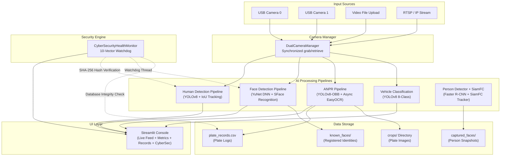

---

## 3. Data Flow Pipeline

The system processes each video frame through the following steps:

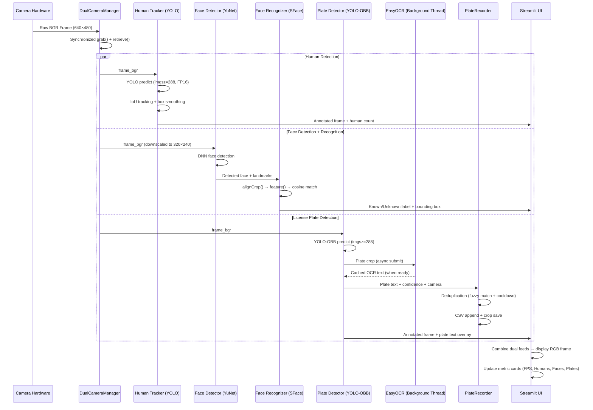

### 3.1 Frame Processing Timing

| Stage | Time Budget | Technique |
|-------|------------|-----------|
| Camera grab + retrieve | ~5 ms | Synchronized dual grab → retrieve (avoids frame skew) |
| YOLO Human Detection | ~8–15 ms | FP16 half-precision, 288px input |
| YuNet Face Detection | ~3–6 ms | 320×240 downscale, DNN forward pass |
| SFace Embedding | ~4–8 ms | Pre-computed known database, cosine match |
| YOLO Plate Detection | ~8–15 ms | OBB model, 288px input |
| EasyOCR | ~80–200 ms | **Async background thread** (does not block main loop) |
| Frame rendering + display | ~2–5 ms | OpenCV draw + Streamlit `st.image()` |
| **Total per frame** | **~30–50 ms** | **≈ 20–33 FPS** |

---

## 4. Module-by-Module Architecture

### 4.1 Human Detection Module (`human_detector.py`)

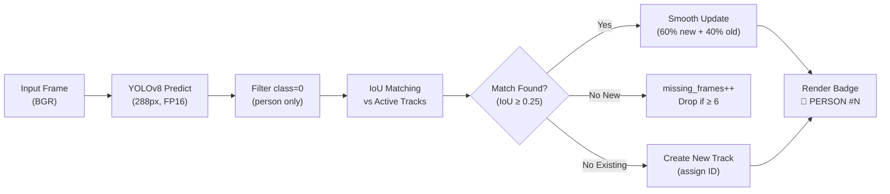

**Key Design Decisions:**
- **Box Smoothing**: New detections are blended with previous positions using a **60/40 weighted average** (`0.6 * new + 0.4 * old`). This prevents jittery bounding boxes that would occur from raw per-frame detections.
- **Track Persistence**: A track survives up to 6 frames without detection before being dropped. This handles momentary occlusions (when a person walks behind an object briefly).
- **FP16 Inference**: On NVIDIA GPUs, the model runs in half-precision floating point (16-bit instead of 32-bit), which approximately **doubles** inference speed.

---

### 4.2 Face Detection & Recognition Module (`face_tracker.py`)

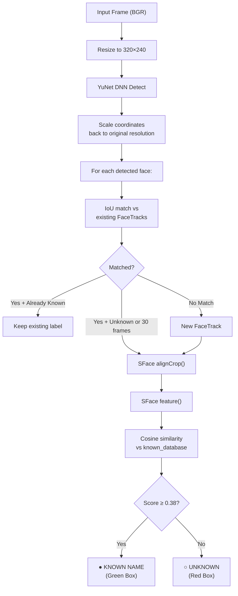

**Two-Stage Face Recognition:**

1. **Stage 1 — YuNet Detection**: OpenCV's YuNet is a DNN-based face detector that outputs face bounding boxes **plus 5 facial landmarks** (2 eyes, nose tip, 2 mouth corners). These landmarks enable precise face alignment.

2. **Stage 2 — SFace Recognition**: The SFace engine takes the aligned face crop and produces a high-dimensional **embedding vector** (a list of numbers that represents the "identity" of a face). The system then compares this embedding against all registered faces using **cosine similarity** (a mathematical measure of how similar two vectors are — 1.0 = identical, 0.0 = completely different).

**Embedding Caching**: The system only re-computes the SFace embedding every 30 frames for already-known faces. This saves approximately 70% of face recognition compute.

---

### 4.3 ANPR Detection Module (`anpr_detector.py`)

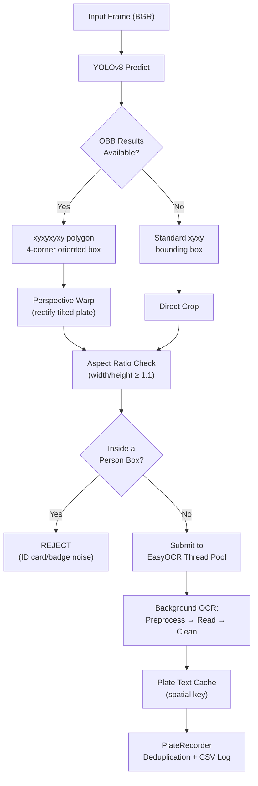

**Why Async OCR?**
EasyOCR is computationally expensive (~100-200ms per plate). If OCR ran on the main thread, the video feed would freeze every time a plate was detected. Instead, the system uses a **ThreadPoolExecutor** with 2 worker threads. The main detection loop submits OCR jobs and immediately continues processing the next frame. When OCR finishes, the result is written to a **cache dictionary** that the main loop reads on subsequent frames.

**Person Rejection Logic**: The system checks if a detected "plate" bounding box overlaps with any human bounding box (IoU > 30% or center point inside). This prevents ID cards, employee badges, and printed text on clothing from being falsely logged as license plates.

---

### 4.4 Hybrid Person Detector + SiamFC Tracker (`person_detector.py`)

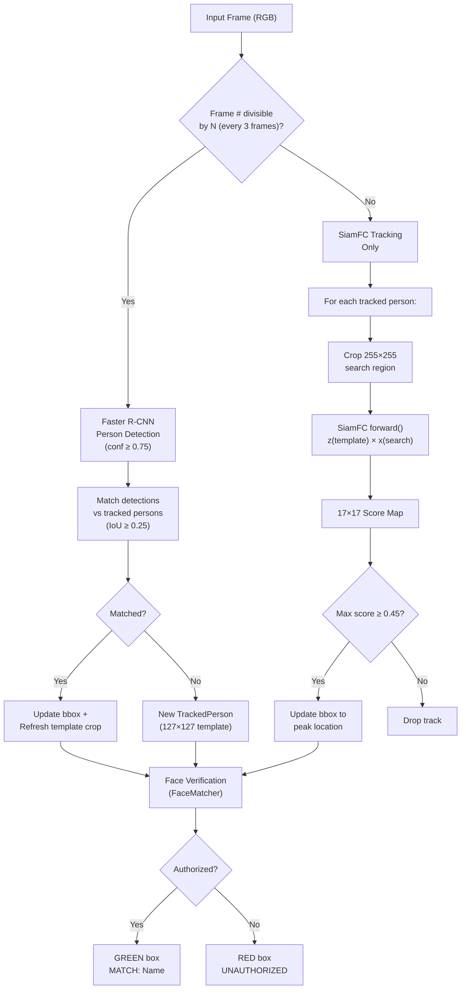

**The Detect-Then-Track Paradigm:**

This is the most sophisticated module in the system. It combines **two fundamentally different approaches**:

1. **Detection (Faster R-CNN)**: A heavy but accurate neural network that scans the entire frame for persons. This runs only every 3 frames to save GPU compute. It acts as the "ground truth" that discovers new people and validates existing tracks.

2. **Tracking (SiamFC)**: A lightweight Siamese network that tracks a specific person across frames by **cross-correlating** a small template image (127×127 pixels of the person) against a search region (255×255 pixels around their last known position). The output is a 17×17 score map where the peak indicates the person's new position.

**Why This Hybrid?**
- Detection-only: Accurate but slow (~50ms per frame). Cannot maintain identity across frames.
- Tracking-only: Fast but drifts over time. Cannot discover new people.
- **Hybrid**: Detection runs every 3rd frame to anchor the tracks. SiamFC fills in the 2 frames in between. This gives both **accuracy and speed**.

---

### 4.5 Vehicle Detection Module (`vehicle_detector.py`)

The vehicle detector follows the same architecture as the human detector but classifies into 8 categories:

| Class ID | Vehicle Type | Emoji Badge |
|----------|-------------|-------------|
| 0 | Bus | 🚌 BUS |
| 1 | Car | 🚗 CAR |
| 2 | E-Bike | 🚲 E-BIKE |
| 3 | Jeep | 🚙 JEEP |
| 4 | Motorcycle | 🏍️ MOTORCYCLE |
| 5 | Tricycle | 🛺 TRICYCLE |
| 6 | Truck | 🚚 TRUCK |
| 7 | Van | 🚐 VAN |

---

### 4.6 Plate Recorder Module (`plate_recorder.py`)

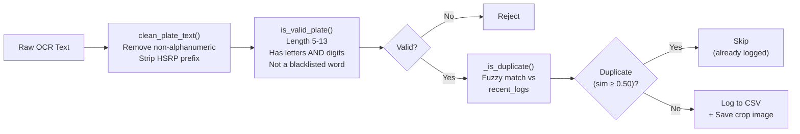

**Fuzzy String Matching**: OCR is imperfect. The same plate viewed 2 seconds apart might be read as `MH12AB1234` and `MH12A81234` (the 'B' misread as '8'). The system uses **SequenceMatcher** to compute a similarity ratio between the candidate and all recently logged plates. If the similarity exceeds 50%, the system considers it a duplicate and skips logging. This prevents the same vehicle from generating dozens of records.

---

## 5. AI Model Architectures (Deep Dive)

### 5.1 SiamFC (Siamese Fully-Convolutional Network)

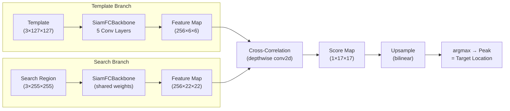

**How Cross-Correlation Works**: Think of the template as a "stamp." The system slides this stamp over every position in the search region and measures how well they match. The position with the highest match score is where the tracked object has moved to.

**Architecture Details:**
- Conv1: 3→96 channels, 11×11 kernel, stride 2
- Conv2: 96→256, 5×5 kernel, grouped convolution
- Conv3: 256→384, 3×3 kernel
- Conv4: 384→384, 3×3 kernel, grouped
- Conv5: 384→256, 3×3 kernel, grouped (no activation — raw features)

---

### 5.2 FaceDetectorNet (MobileFaceNet-Inspired)

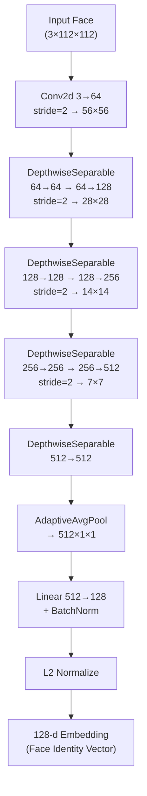

**What is a Depthwise Separable Convolution?**
A regular convolution with C_in input channels and C_out output channels using a K×K kernel needs `C_in × C_out × K × K` parameters. A depthwise separable convolution splits this into two steps:
1. **Depthwise**: Apply one K×K filter per channel independently → `C_in × K × K` parameters
2. **Pointwise**: Mix channels using 1×1 convolutions → `C_in × C_out` parameters

This reduces parameters by ~8-9× while maintaining similar accuracy. This is crucial for real-time face recognition on limited hardware.

---

## 6. Cybersecurity Architecture

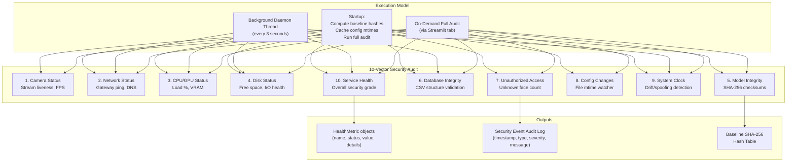

### Security Grading System

| Grade | Condition | Meaning |
|-------|-----------|---------|
| **OPTIMAL** | All 10 vectors are "OK" | System fully secure and operational |
| **WARNING** | Any vector is "WARNING" | Minor issues (high CPU, single camera offline, etc.) |
| **CRITICAL** | Any vector is "CRITICAL" | Security violation (model tampering, DB corruption, disk full) |

### Model Integrity Verification (SHA-256)

At startup, the system computes a **SHA-256 cryptographic hash** of every AI model weight file (`.pt` and `.onnx`). SHA-256 produces a unique 64-character hexadecimal fingerprint for any file. If even a single byte of the model is changed, the hash will be completely different. The system periodically re-computes these hashes and compares against the baseline. If a mismatch is found, a **CRITICAL: MODEL TAMPERING DETECTED** alert is raised.

---

## 7. Camera & Input Management

### DualCameraManager Architecture

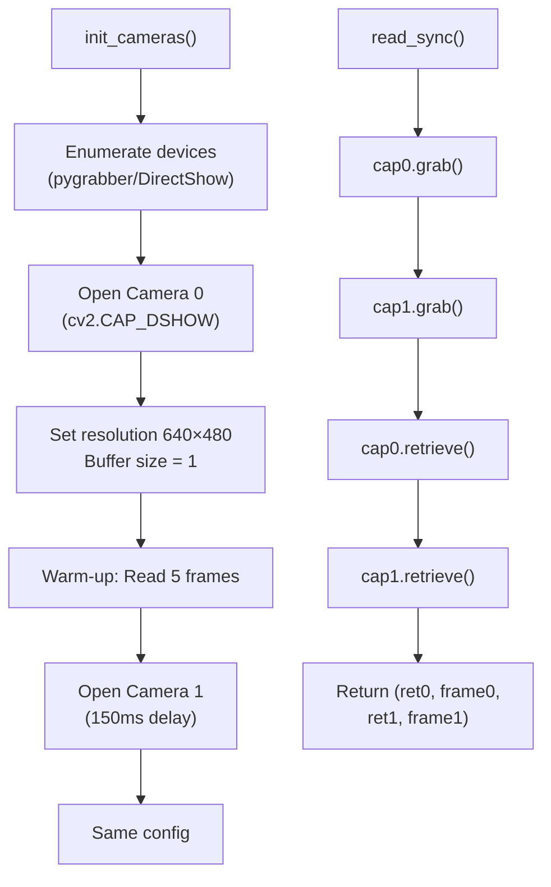

**Why Grab-Then-Retrieve?**
USB cameras have internal buffers. If you call `cap.read()` sequentially on two cameras, Camera 1's frame might be captured 30-50ms after Camera 0's frame — causing visible temporal desync in the dual view. By calling `grab()` on both cameras first (which takes the snapshot but doesn't decode it), then `retrieve()` on both (which decodes the already-captured snapshot), both frames are captured as close in time as possible.

**Buffer Size = 1**: Setting `CAP_PROP_BUFFERSIZE = 1` ensures the system always gets the **latest** frame, not an old buffered frame. Without this, there could be a 3-5 frame lag.

---

## 8. Data Storage Architecture

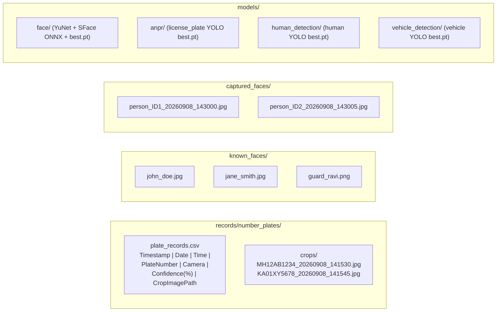

### CSV Record Schema

| Column | Type | Example |
|--------|------|---------|
| Timestamp | datetime | 2026-09-08 14:15:30 |
| Date | date | 2026-09-08 |
| Time | time | 14:15:30 |
| PlateNumber | string | MH12AB1234 |
| Camera | string | Cam 0 (Integrated Webcam) |
| Confidence(%) | float | 87.3 |
| CropImagePath | path | crops/MH12AB1234_20260908_141530.jpg |

---

## 9. UI Architecture (Streamlit Console)

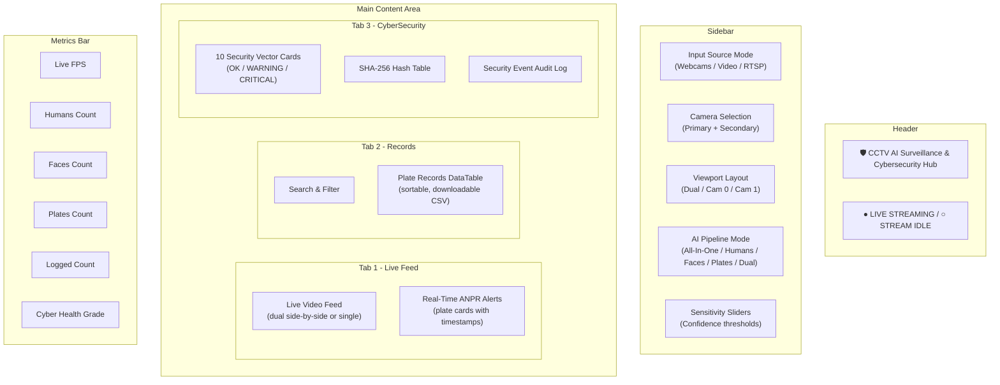

---

## 10. Offline-First Design Philosophy

| Aspect | Online Alternative | IBVAP Offline Approach |
|--------|-------------------|----------------------|
| Face Recognition | AWS Rekognition, Azure Face API | Local SFace + custom FaceDetectorNet |
| OCR | Google Vision API | Local EasyOCR engine |
| Object Detection | Cloud ML endpoints | Local YOLOv8 with CUDA |
| Data Storage | Cloud database | Local CSV + filesystem |
| Model Hosting | Model-as-a-Service | Local `.pt` / `.onnx` files |
| UI | Cloud-hosted dashboard | Local Streamlit (`localhost:8501`) |
| Security Monitoring | SIEM cloud services | Local CyberSecurityHealthMonitor |

> [!IMPORTANT]
> **Zero data leaves the machine.** All video frames, face embeddings, plate text, and recognition results stay on the local disk. The system can operate in a completely **air-gapped** environment (no internet cable, no Wi-Fi).

---

## 11. Glossary of Difficult Terms

### AI & Machine Learning Terms

| Term | Simple Explanation |
|------|-------------------|
| **Inference** | Running a trained model on new data to get predictions (as opposed to "training" which is teaching the model) |
| **Embedding** | A fixed-length list of numbers (e.g., 128 numbers) that captures the "essence" of something. Two face images of the same person will produce similar embeddings, while different people produce very different embeddings |
| **Cosine Similarity** | A measure of how similar two lists of numbers are. It computes the cosine of the angle between two vectors — 1.0 means identical direction (same person), 0.0 means perpendicular (unrelated), -1.0 means opposite |
| **L2 Distance (Euclidean)** | The straight-line distance between two points in high-dimensional space. Smaller distance = more similar. Used as an alternative to cosine similarity for face matching |
| **Cross-Correlation** | Sliding one small image (template) over a larger image (search region) and measuring similarity at each position. The peak in the resulting score map indicates where the template appears in the search region |
| **FP16 / Half Precision** | Using 16-bit floating-point numbers instead of 32-bit. This doubles the amount of data that fits in GPU memory and typically doubles processing speed, with minimal accuracy loss |
| **Confidence Threshold** | The minimum "certainty score" (0.0 to 1.0) a model must produce for a detection to be accepted. Lower threshold = more detections but more false alarms. Higher threshold = fewer but more reliable detections |
| **Transfer Learning** | Starting with a model that was already trained on a large dataset (like ImageNet with millions of images) and then fine-tuning it on your specific data (like Indian license plates). This requires far less data and training time than starting from scratch |

### Computer Vision Terms

| Term | Simple Explanation |
|------|-------------------|
| **Bounding Box** | A rectangle drawn around a detected object, defined by its top-left corner coordinates and width/height — e.g., `(x=100, y=200, w=50, h=80)` |
| **IoU (Intersection over Union)** | A measure of how much two bounding boxes overlap. IoU = Area of Overlap / Area of Union. An IoU of 1.0 means perfect overlap; 0.0 means no overlap. Used to match detections across frames (tracking) |
| **OBB (Oriented Bounding Box)** | A rotated rectangle that can be tilted at any angle, unlike a standard axis-aligned bounding box. Used for license plates that appear at an angle in the image |
| **Perspective Warp** | Mathematically "unrotating" an angled image to make it appear flat and straight (head-on). Used to rectify tilted license plates before OCR |
| **CLAHE** | Contrast Limited Adaptive Histogram Equalization — an image processing technique that improves contrast in different regions of an image independently, making text on plates more readable in varying lighting |
| **DNN Module** | OpenCV's Deep Neural Network module — allows running pre-trained neural networks (like YuNet, SFace) without needing PyTorch or TensorFlow |
| **Haar Cascade** | A classical (non-deep-learning) face detection algorithm. Fast but less accurate than DNN-based detectors. Used as a fallback when the YuNet model is unavailable |
| **BGR vs RGB** | Two ways to store color pixels. OpenCV uses BGR (Blue-Green-Red) order; most other libraries use RGB (Red-Green-Blue). Converting between them (`cvtColor`) is essential to avoid color-inverted images |

### Neural Network Architecture Terms

| Term | Simple Explanation |
|------|-------------------|
| **Siamese Network** | A neural network architecture with two identical sub-networks that share the same weights. Each sub-network processes one input, and their outputs are compared. Named after Siamese twins because of the twin structure |
| **Depthwise Separable Convolution** | A computationally efficient alternative to standard convolutions. It processes each color channel independently (depthwise), then combines them (pointwise). Uses ~8× fewer calculations |
| **Backbone** | The core feature extraction portion of a neural network that processes raw pixels into meaningful features. The "backbone" is reused across different tasks (detection, tracking, classification) |
| **Score Map** | A 2D grid of numbers produced by a tracking network. Each cell in the grid represents how likely the tracked object is at that position. The cell with the highest number is where the object most likely is |
| **Adaptive Average Pooling** | A layer that takes any size input and produces a fixed-size output by averaging groups of values. `AdaptiveAvgPool2d(1)` collapses a feature map of any spatial size to 1×1, creating a single summary number per channel |

### Tracking & Detection Terms

| Term | Simple Explanation |
|------|-------------------|
| **Detection vs Tracking** | Detection finds objects in a single frame (doesn't know it's the same person frame-to-frame). Tracking maintains identity across frames (knows Person #3 in frame 10 is the same Person #3 in frame 11) |
| **Track ID** | A unique number assigned to each tracked object. Even if a person leaves the frame and returns, they get a new Track ID (re-identification is not performed) |
| **Box Smoothing** | Blending the new detection position with the previous position to create a smooth trajectory. Without smoothing, bounding boxes would "jitter" due to slight frame-to-frame variations |
| **Template (127×127)** | A small cropped image of the tracked object used as a reference. The SiamFC tracker compares this template against the search region in each new frame |
| **Search Region (255×255)** | A larger crop centered on the object's last known position. The tracker searches within this region to find where the object has moved |

### ANPR & OCR Terms

| Term | Simple Explanation |
|------|-------------------|
| **ANPR** | Automatic Number Plate Recognition — the complete pipeline of detecting a plate, reading its text, and logging it |
| **OCR** | Optical Character Recognition — converting an image of text into machine-readable text strings |
| **HSRP** | High Security Registration Plate — India's standardized license plate format with a blue holographic stripe containing "IND" text. The system strips this prefix to get the actual plate number |
| **Fuzzy Matching** | Comparing two text strings and computing a similarity score even when they're not exactly identical. "MH12AB1234" vs "MH12A81234" might have 90% similarity, indicating they're probably the same plate with a single OCR error |
| **Deduplication** | Preventing the same plate from being logged multiple times. Uses a cooldown timer (default 45 seconds) plus fuzzy matching to ensure each vehicle is recorded exactly once |

### Cybersecurity Terms

| Term | Simple Explanation |
|------|-------------------|
| **SHA-256** | A cryptographic hash function that converts any file into a unique 64-character hexadecimal string. Even changing a single byte in the file produces a completely different hash. Used to verify that model weights haven't been tampered with |
| **Model Tampering** | Maliciously modifying AI model weights to change their behavior (e.g., making the face recognizer always say "authorized"). SHA-256 checksums detect this |
| **Watchdog Thread** | A background thread that continuously monitors system health metrics every 3 seconds, independent of the main video processing loop |
| **Air-Gapped** | A computer that has no network connection whatsoever — physically disconnected from the internet. IBVAP is designed to work in air-gapped environments |
| **Monotonic Clock** | A clock that only moves forward and cannot be set backwards. The system uses `time.monotonic()` to detect if someone attempts to change the system clock to replay old timestamps |

### UI & Framework Terms

| Term | Simple Explanation |
|------|-------------------|
| **Streamlit** | A Python framework that creates web applications with minimal code. It turns Python scripts into interactive web pages that run locally on `localhost:8501` |
| **Session State** | Streamlit's mechanism for storing data that persists across page reruns. Used to track whether streaming is active, which plates have been detected, etc. |
| **Glassmorphism** | A UI design trend featuring semi-transparent backgrounds with backdrop blur, creating a "frosted glass" effect. Used in the metric cards and security vector cards |
| **DirectShow** | A Windows multimedia framework for accessing cameras and video devices. The `pygrabber` library uses DirectShow to enumerate USB camera names |
