# 📋 Hackathon Task Distribution & Technical Responsibilities (6-Member Team)

> **Project:** Intelligent Biometric & Video Analytics Platform (IBVAP)  
> **Structure:** Combined AI & Streaming Core + Dedicated Engineering & 2 Research Roles

---

## 👥 Core Domain Matrix (6 Members)

```
┌──────────────────────────────────────────────────────────────────────────────────────────────────┐
│                                   HACKATHON DOMAIN RESPONSIBILITIES                              │
├──────────────────────────┬──────────────────────────┬────────────────────────────────────────────┤
│ 🤖⚙️ Member 1             │ 🎨 Member 2              │ 🗄️ Member 3                                │
│ AI Models & Backend      │ Frontend Design (UI/UX)  │ Database & Storage                         │
│ Streaming Pipeline       │ & Dashboard              │ Architecture                               │
├──────────────────────────┼──────────────────────────┼────────────────────────────────────────────┤
│ 🛡️ Member 4              │ 🔬 Member 5              │ 📊 Member 6                                │
│ Cyber Security &         │ AI & Computer Vision     │ Product, Market & Cyber                    │
│ System Health Monitor    │ Algorithms Research      │ Forensics Research (Pitch)                 │
└──────────────────────────┴──────────────────────────┴────────────────────────────────────────────┘
```

| Member | Technical Domain | Primary Focus | Key Deliverables & Files |
| :--- | :--- | :--- | :--- |
| **Member 1** | **AI Models & Backend Pipeline Lead** | Model fine-tuning, multi-cam ingestion, threading, pipeline orchestration | `main.py`, `main_3cam.py`, `scripts/train_crowd.py`, `src/person_detector.py` |
| **Member 2** | **Frontend Design (UI/UX)** | Visual console, dark-mode design, multi-cam grid, alert hub | `streamlit_app.py`, `desktop_ui.py`, `app.py`, custom CSS |
| **Member 3** | **Database & Data Management** | Vector DB / SQLite, schema design, face embeddings, plate logs | `records/`, `known_faces/`, `captured_faces/`, `src/plate_recorder.py` |
| **Member 4** | **Cyber Security & System Health** | Tamper detection, stream security, CPU/GPU telemetry, watchdog | `src/cyber_health_monitor.py`, security auditing |
| **Member 5** | **AI & Vision Algorithms Research** | SOTA architectures, crowd density research, face anti-spoofing, quantization benchmarks | Algorithm benchmarking report, research documentation, model comparisons |
| **Member 6** | **Product & Domain Research (Pitch Lead)** | Market/competitor research, offline edge viability, pitch deck narrative, live demo lead | Pitch deck slides, demo script, business & privacy compliance analysis |

---

## 📌 Detailed Role & Task Breakdown

---

### 🤖⚙️ Member 1: AI Models & Backend Streaming Pipeline Lead
*(Combined Role: Deep Learning Models + Multi-Camera Video Ingestion & Pipeline)*

#### 🎯 Key Responsibilities:
1. **AI Model Fine-Tuning & Inference:**
   - [ ] Train and optimize crowd density model using [scripts/train_crowd.py](file:///c:/Users/asus/OneDrive/Desktop/cctvvvv/scripts/train_crowd.py).
   - [ ] Fine-tune and load YOLOv8 models (`yolov8n.pt`, `yolov8s.pt`, `yolov8n-obb.pt`) for human detection and oriented license plate recognition.
   - [ ] Calibrate SFace face embedding model in [src/face_model.py](file:///c:/Users/asus/OneDrive/Desktop/cctvvvv/src/face_model.py).
2. **Multi-Camera Ingestion & Concurrency:**
   - [ ] Implement multi-threaded video capture in [main.py](file:///c:/Users/asus/OneDrive/Desktop/cctvvvv/main.py) and [main_3cam.py](file:///c:/Users/asus/OneDrive/Desktop/cctvvvv/main_3cam.py) (USB webcams, RTSP IP streams, and video files).
   - [ ] Build circular frame buffers and async worker queues so heavy tasks (OCR/embeddings) do not drop video FPS.
3. **Pipeline Orchestration:**
   - [ ] Connect all 6 AI detection pipelines to run on incoming frames and send output annotations to the UI stream.
   - [ ] Add auto-reconnect logic for dropped camera feeds.

* **Definition of Done (DoD):** Ingests 2–3 camera streams concurrently at stable 20–30 FPS with all AI detection pipelines active without crashes.

---

### 🎨 Member 2: Frontend Design (UI/UX) & Interactive Dashboard
**Domain:** UI/UX Design, Live Video Visualization, Alert Components & User Interaction.

#### 🎯 Key Responsibilities:
1. **Surveillance Console Dashboard:**
   - [ ] Build a dark-themed surveillance UI in [streamlit_app.py](file:///c:/Users/asus/OneDrive/Desktop/cctvvvv/streamlit_app.py), [desktop_ui.py](file:///c:/Users/asus/OneDrive/Desktop/cctvvvv/desktop_ui.py), or [app.py](file:///c:/Users/asus/OneDrive/Desktop/cctvvvv/app.py).
   - [ ] Implement responsive multi-camera video layout (1-Cam, 2-Cam, 3-Cam grid views).
2. **Real-Time Overlays & HUD:**
   - [ ] Draw real-time bounding boxes with color codes (Green = Known Face, Red = Blacklist/Flagged, Blue = Person, Yellow = Crowd).
   - [ ] Display real-time telemetry HUD (live FPS, crowd count, camera status).
3. **Alert Center & Interaction:**
   - [ ] Build slide-out alert panel for instant security warnings (audio chime + snapshot preview).
   - [ ] Create interactive controls (sensitivity sliders, camera selectors, snapshot export buttons).

* **Definition of Done (DoD):** Modern, visually striking UI console rendering real-time annotated camera feeds with zero UI lag.

---

### 🗄️ Member 3: Database, Vector Store & Historical Logging
**Domain:** Database Architecture, Face Vector Storage, Event Logging & Fast Retrieval.

#### 🎯 Key Responsibilities:
1. **Database Schema & Storage Engine:**
   - [ ] Design and initialize a local SQLite / DuckDB database for events, biometric logs, and plate detections.
   - [ ] Structure tables for: `face_logs`, `anpr_records`, `crowd_events`, `system_alerts`.
2. **Face Vector Store & Matcher:**
   - [ ] Build vector embedding index in [src/face_matcher.py](file:///c:/Users/asus/OneDrive/Desktop/cctvvvv/src/face_matcher.py) and `known_faces/` database with fast similarity search (Cosine/L2 distance).
   - [ ] Implement startup caching so known face embeddings load in milliseconds.
3. **Search & Report Generation:**
   - [ ] Build search queries (filter by time range, plate number, person name, camera ID).
   - [ ] Manage thumbnail storage in `captured_faces/` and `records/` with CSV/PDF export.

* **Definition of Done (DoD):** Database logs events under 5ms, face matching searches embeddings in <10ms, and queries return instant historical results.

---

### 🛡️ Member 4: Cyber Security, Camera Integrity & System Health
**Domain:** Cyber Security, Anti-Tamper Detection, System Telemetry & Offline Resilience.

#### 🎯 Key Responsibilities:
1. **Anti-Tamper & Stream Integrity:**
   - [ ] Implement video stream tamper detection in [src/cyber_health_monitor.py](file:///c:/Users/asus/OneDrive/Desktop/cctvvvv/src/cyber_health_monitor.py) (detects camera occlusion, black screen, lens spray, camera disconnect).
   - [ ] Add RTSP stream integrity checking and replay anomaly detection.
2. **System Health Telemetry:**
   - [ ] Build real-time resource monitor for CPU %, GPU VRAM %, RAM usage, and frame drop rates.
   - [ ] Implement auto-throttling / fallback mechanism if system load exceeds safe thresholds.
3. **Offline Security & Access Control:**
   - [ ] Enforce strict air-gap compliance (zero unauthorized outbound connections).
   - [ ] Add basic authentication / role separation (Admin vs Operator view).

* **Definition of Done (DoD):** Instant alerts on camera tampering/occlusion (<1s), live health telemetry displayed on dashboard.

---

### 🔬 Member 5: AI & Computer Vision Algorithms Research
**Domain:** Deep Learning Literature, Model Architecture Evaluation, SOTA Benchmarking & Algorithm Design.

#### 🎯 Key Responsibilities:
1. **SOTA Model Evaluation & Algorithmic Research:**
   - [ ] Research and document state-of-the-art architectures for edge surveillance (e.g. YOLOv8 vs YOLOv10/11, CSRNet vs DM-Count for crowds, SFace vs ArcFace).
   - [ ] Investigate lightweight Face Anti-Spoofing (Liveness detection) techniques to prevent 2D photo bypass attacks.
2. **Performance Benchmarking & Trade-Off Analysis:**
   - [ ] Conduct comparative latency vs. accuracy trade-off analysis (mAP vs FPS across FP32, FP16, and INT8 ONNX models).
   - [ ] Research crowd density counting algorithms under extreme occlusion and low-light CCTV conditions.
3. **Research Documentation & Algorithm Justification:**
   - [ ] Author the **Algorithm & Technical Research Report** to justify model choices to hackathon judges.
   - [ ] Supply mathematical formulations and architecture diagrams for the pitch presentation.

* **Definition of Done (DoD):** Comprehensive Algorithm Research Document with benchmark comparison tables, model trade-off analysis, and research defense points for judges.

---

### 📊 Member 6: Product, Domain & Cyber-Forensics Research (Pitch Lead)
**Domain:** Market Research, Edge CCTV Feasibility, Pitch Deck Storyline & Live Demo Execution.

#### 🎯 Key Responsibilities:
1. **Market, Industry & Regulatory Research:**
   - [ ] Research the Smart Surveillance & Edge AI market size, target sectors (airports, campuses, smart cities, defense), and competitor shortcomings (cloud-dependent lag/privacy risks).
   - [ ] Document offline-first privacy advantages (GDPR, biometric compliance, zero cloud leakage).
2. **Pitch Deck & Narrative Construction:**
   - [ ] Build a 8–10 slide winning pitch deck: Problem Statement, Market Opportunity, Offline AI Architecture, Key Innovations, Business Model, and Future Roadmap.
   - [ ] Incorporate research findings from Member 5 into compelling visual infographics and statistics.
3. **Live Demo Direction & Judge Q&A Prep:**
   - [ ] Script a high-impact 3-minute live judging demo flow with clear cue points.
   - [ ] Prepare curated test datasets (team member faces in `known_faces/`, parking lot video clips) and backup screen recordings.
   - [ ] Rehearse judge Q&A defense (cost reduction, offline edge scalability, cyber robustness).

* **Definition of Done (DoD):** High-converting pitch deck complete, demo test scenarios primed, and rehearsed 3-minute presentation ready.

---

## ⏱️ 36-Hour Hackathon Milestone Timeline

```mermaid
gantt
    title Hackathon 36-Hour Technical Roadmap
    dateFormat  X
    axisFormat  Hour %d
    
    section 1. Foundation & Setup
    Repo Sync & Dependencies (All)              :0, 4
    Research SOTA & Market Strategy (M5, M6)    :0, 6
    
    section 2. Core Build & In-Depth Research
    AI Models & Ingestion Pipeline (M1)         :4, 16
    UI Console Wireframes & Design (M2)         :4, 14
    Database Schema & Vector Search (M3)        :4, 14
    Cyber Tamper & Telemetry Monitor (M4)       :4, 14
    Algorithm Benchmarks & Metrics (M5)         :6, 18
    Market Analysis & Pitch Structure (M6)      :6, 18
    
    section 3. Integration & Interconnection
    Connect Streaming Engine to UI (M1, M2)     :14, 22
    Connect AI Models to DB & Alerts (M1,M3,M4) :16, 24
    
    section 4. Optimization & Polish
    FPS Tuning & Latency Benchmarks (M1, M5)    :22, 28
    UI Polish, Dark Theme & Overlays (M2)       :22, 28
    
    section 5. Testing, Pitch & Demo
    End-to-End Stress QA & Bug Bash (All)       :28, 32
    Slide Deck Finalization & Demo Dry Run (M6) :28, 36
```



---

## 🤝 Cross-Domain Workflow & Collaboration

```
┌──────────────────────────────────────────────────────────────────────────────────────────┐
│                                    COLLABORATION FLOW                                    │
│                                                                                          │
│  [ Member 5: Vision Research ] ──► Algorithmic Insights ──► [ Member 1: AI & Pipeline ]  │
│                                                                        │                 │
│                                            Sends Processed Video Stream│                 │
│                                                                        ▼                 │
│  [ Member 3: Database/Vectors] ◄── Detections / Embeddings ── [ Member 2: UI Dashboard ] │
│                │                                                       ▲                 │
│                └──────────────── Alert Signals & Health ───────────────┤                 │
│                                                                        │                 │
│  [ Member 4: Cyber & Health  ] ────────────────────────────────────────┘                 │
│                                                                                          │
│  [ Member 6: Product & Pitch ] ◄── Collects Benchmarks & Leads Live Demo Presentation    │
└──────────────────────────────────────────────────────────────────────────────────────────┘
```

---

## 🏆 Final Pre-Demo Verification Checklist

- [ ] **AI & Streaming (M1):** Multi-cam streams run at 20+ FPS with all 6 AI pipelines functioning locally.
- [ ] **Frontend UI (M2):** Dark-mode console renders live multi-grid feeds smoothly with live HUD overlay.
- [ ] **Database (M3):** Face matches and vehicle plate records save instantly and can be queried in UI.
- [ ] **Cyber Security (M4):** Covering/tampering with a camera triggers an instant alert on the UI.
- [ ] **Algorithm Research (M5):** Benchmark tables and algorithm justification ready for judge questions.
- [ ] **Pitch & Demo (M6):** Presentation deck polished; live demo rehearsed with backup video clips.
